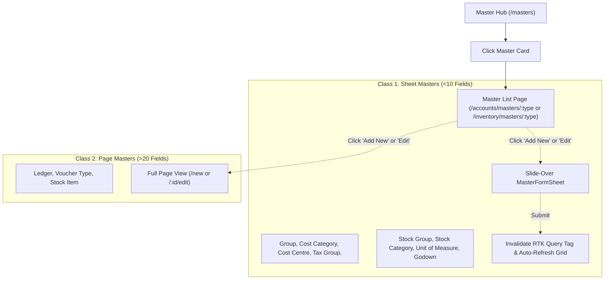

# Master Lists Development Guide

This skill defines the enterprise architecture, UI/UX standards, and implementation workflow for developing **Master List pages** across the ERP.

> **Original Architecture Plan**:
> - **Artifact Path**: `/Users/manish/.gemini/antigravity/brain/9157d47d-4fb4-4068-b371-7859b68bc891/implementation_plan_01_master_lists.md`
> - **Artifact Link**: [Implementation Plan 01: Enterprise Master List Architecture & UI/UX Design](file:///Users/manish/.gemini/antigravity/brain/9157d47d-4fb4-4068-b371-7859b68bc891/implementation_plan_01_master_lists.md)

---

## 1. Key Rules Learned from Group Master (Critical)

During the implementation of Group Master, critical design decisions and anti-patterns were established. **You must strictly follow these rules for every Master list**:

### 1.1 Row-Level Icons: DO NOT Repeat Icons on Rows
- ❌ **Anti-pattern**: Displaying an entity icon (e.g., `Layers`, `Building2`, `Boxes`) in front of every row's entity name.
- ✅ **Rule**: The entity icon belongs **exclusively in the page header** next to the title.
- **Table Cell**: The entity name cell must contain **only clean, bold/semibold typography** (`text-xs sm:text-sm font-semibold text-foreground`). No row-level icons.

### 1.2 Hierarchy & Parent Column: Plain Text (NO Pills)
- ❌ **Anti-pattern**: Using pill badges, colored backgrounds, borders, or arrows for parent groups or top-level items.
- ✅ **Primary / Top-Level Records**: Render simple, muted plain text without pills, backgrounds, borders, or icons:
  ```tsx
  <span className="text-muted-foreground/70 text-xs font-normal">Primary</span>
  ```
- ✅ **Sub-records (Children)**: Render plain text with a subtle, monospaced indented hierarchy indicator (`↳`):
  ```tsx
  <div className="flex items-center gap-1.5 text-xs text-foreground font-normal min-w-0">
    <span className="text-muted-foreground font-mono text-sm leading-none shrink-0">↳</span>
    <span className="truncate">{parentName}</span>
  </div>
  ```
- **Pill Usage Rule**: Reserve pill shapes **strictly for states and statuses** (e.g., `Active`/`Inactive`, `Predefined`/`Custom`, or Category badges).

### 1.3 In-Place Slide-Over Sheet Editing (DRY Principle)
- ❌ **Anti-pattern**: Building inline table row editing. It introduces duplicate validation, state management, inputs, and ~200 lines of redundant code.
- ✅ **Rule**: For all **Class 1 Sheet Masters**, clicking **Edit** must open the existing master form inside the slide-over `MasterFormSheet`:
  ```ts
  openMasterSheet(masterType, 'edit', rowRecord);
  ```
- Reuses the existing `schema.ts`, validation, and `AutoSuggest` components without duplicating a single field.

### 1.4 Refactor Deletion Dialogs into Separate Components
- ❌ **Anti-pattern**: Inlining modal JSX and delete confirmation logic inside the main page component.
- ✅ **Rule**: Extract deletion modals into standalone components (`Delete<Master>Modal.dom.tsx`) following `react-best-practices-M2`:
  - Receives `isOpen`, `record`, `isDeleting`, `onClose`, and `onConfirm`.
  - Uses `@prime/ui` (`Modal`, `ModalHeader`, `ModalTitle`, `ModalDescription`, `ModalFooter`, `Button`, `Icon`).

### 1.5 Predefined Record Protection (`is_predefined`)
- System-predefined records (`record.is_predefined === true`) have referential integrity protection:
  - Both **Edit** and **Delete** buttons are **disabled**.
  - Wrapped in `@prime/ui` `<Tooltip>` explaining why (e.g. *"Predefined system masters cannot be edited/deleted"*).
  - Use `size="icon" variant="ghost"` with `opacity-30 cursor-not-allowed pointer-events-none`.

### 1.6 Compact Action Column
- Keep action columns tight (width ~`75px`).
- Align buttons to the right (`justify-end gap-1 w-full pr-1`).
- Avoid dead whitespace between the data columns and actions.

### 1.7 True API Schema Alignment & Detail Query on Edit
- ❌ **Anti-pattern**: Inventing phantom keys (such as `parent_id` or `parent_name`) on master list records when the list endpoint (`GET /accounting/groups`) only returns summary fields.
- ✅ **Rule**: The list table and filter tabs must strictly reflect keys present in the real API response (`name`, `alias`, `classification`, `category`, `sub_category`, `is_predefined`, `is_active`).
- **Edit Detail Query**: When detailed relational fields (like `parent_id` or `code`) are needed for the Edit form but absent in the list payload, fetch them on-demand inside the form hook using `useGet<Master>ByIdQuery(id, { skip: mode !== 'edit' })`.

---

## 2. Master Classification & Operations

Masters are divided into two operational classes:



### Master-by-Master Specification Matrix

| Master ID | Name | Parent Column | Primary Columns | Form Mode | RTK Tag |
| :--- | :--- | :--- | :--- | :--- | :--- |
| `group` | Account Group | No (`primary_group_name` column; `parent_name` loaded via `GET /:id` for Edit) | Name, Alias, Primary Group, Classification, Category, Type, Status, Actions | `sheet` | `'Group'` |
| `cost-category` | Cost Category | No | Name, Alias, Allocate Revenue, Allocate Non-Revenue, Actions | `sheet` | `'CostCategory'` |
| `cost-centre` | Cost Centre | **Yes** (`parent_id`) | Name, Cost Category, Parent Centre, Actions | `sheet` | `'CostCentre'` |
| `tax-group` | Tax Group | No | Name, Components Count, Rates Summary, Actions | `sheet` | `'TaxGroup'` |
| `stock-group` | Stock Group | **Yes** (`parent_id`) | Name, Parent Group, Taxable Flag, Actions | `sheet` | `'StockGroup'` |
| `stock-category` | Stock Category | **Yes** (`parent_id`) | Name, Parent Category, Alias, Actions | `sheet` | `'StockCategory'` |
| `unit-of-measure` | Unit of Measure | No | Symbol, Formal Name, UQC Code, Decimal Places, Actions | `sheet` | `'StockUnit'` |
| `godown` | Godown | **Yes** (`parent_id`) | Name, Parent Godown, Predefined, Actions | `sheet` | `'Godown'` |
| `ledger` | Ledger | No (Group association) | Name, Group, Sub-category, Opening Balance, Bill-wise, Predefined, Actions | `page` (`/ledger/new`) | `'Ledger'` |
| `voucher-type` | Voucher Type | No | Name, Category, Voucher Mode, Tax Applicable, Numbering Scheme, Predefined, Actions | `page` (`/voucher-type/new`) | `'VoucherType'` |
| `stock-item` | Stock Item | No (Group/Cat association) | Name, Item Code, Stock Group, Category, Base Unit, Opening Qty, Tax Rate, Actions | `page` (`/stock-item/new`) | `'StockItem'` |

---

## 3. Standard File & Folder Architecture

Follow this strict modular folder layout under `apps/web/src/features/Masters/pages/<MasterName>ListPage/`:

```
apps/web/src/features/Masters/pages/<MasterName>ListPage/
├── index.ts                     # Module export
├── <MasterName>ListPage.dom.tsx # Pure UI layout & table composition
├── use<MasterName>List.ts       # Logic hook (filtering, search, actions, dialog state)
├── columns.tsx                  # TanStack table column definitions & action cell
├── Delete<MasterName>Modal.dom.tsx # Dedicated delete confirmation modal
└── styles.dom.ts                # Tailwind design token classes
```

### Route Integration (Thin Route Pattern)
Route files under `apps/web/src/routes/...` must be **thin wrappers** (less than 15 lines):
```tsx
import { createFileRoute } from '@tanstack/react-router';
import { GroupListPage } from '@/features/Masters/pages/GroupListPage';

export const Route = createFileRoute('/accounts/masters/group/')({
  component: GroupListPage,
});
```

---

## 4. UI/UX Design System Patterns

### 4.1 Header & Breadcrumbs
- **Breadcrumb**:
  ```tsx
  <Link to="/masters" className="flex items-center gap-1 hover:text-foreground">
    <Icon name="ArrowLeft" size={13} className="opacity-70" />
    <span>Masters Hub</span>
  </Link>
  <span className="text-muted-foreground/40 font-mono">/</span>
  <span>{Domain}</span>
  <span className="text-muted-foreground/40 font-mono">/</span>
  <span className="text-foreground font-semibold">{Master Name}</span>
  ```
- **Header Title**: Entity icon in a rounded container (`w-11 h-11 rounded-xl bg-primary/10 text-primary flex items-center justify-center`).
- **Counter Badge**: `text-xs px-2.5 py-0.5 rounded-full font-medium bg-muted text-muted-foreground`.
- **Action Buttons**:
  - `RefreshCw` icon button (`variant="outline" size="sm"` with animate-spin when loading).
  - `+ Add {Master}` primary button (`variant="primary" size="sm"`).

### 4.2 Toolbar & Search
- Search input with `/` shortcut badge and clear `X` button when populated.
- Keyboard shortcut listener: pressing `/` outside inputs focuses the search bar.
- Filter pill tabs (`All`, `Primary`, `Subgroups`, `Predefined`, `Custom`) with count pills.

### 4.3 Table Configuration (`@prime/ui` Table)
- **Row Height**: `rowHeight={42}` for compact enterprise density.
- **Sticky Header**: `Table.Header className="bg-surface-variant sticky top-0 z-10 border-b border-border h-9"`.
- **Keyboard Navigation**: Rows react to focus state with `data-focused={isFocused}` and `border-l-3 border-l-primary`.
- **Footer**: Summary counter showing `"Showing X of Y items"` and keyboard navigation hint (`Tab and arrow keys`).

---

## 5. RTK Query Mutation & Invalidation Pattern

Ensure the API slice in `apps/web/src/features/Masters/api/` exports mutations with appropriate tag invalidations:
```ts
updateGroup: builder.mutation<Group, { id: string; data: Partial<Group> }>({
  query: ({ id, data }) => ({
    url: `/accounting/groups/${id}`,
    method: 'PUT',
    body: data,
  }),
  invalidatesTags: ['Group'],
}),
deleteGroup: builder.mutation<{ message: string }, string>({
  query: (id) => ({
    url: `/accounting/groups/${id}`,
    method: 'DELETE',
  }),
  invalidatesTags: ['Group'],
}),
```

This guarantees that both creating, updating, and deleting an item automatically refreshes the table grid without manual cache manipulation.
